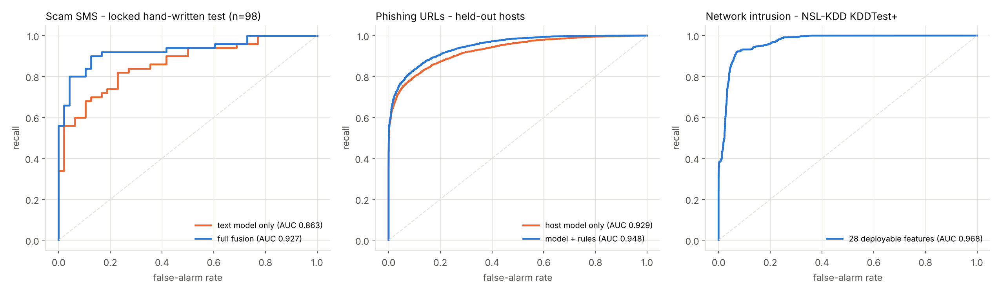
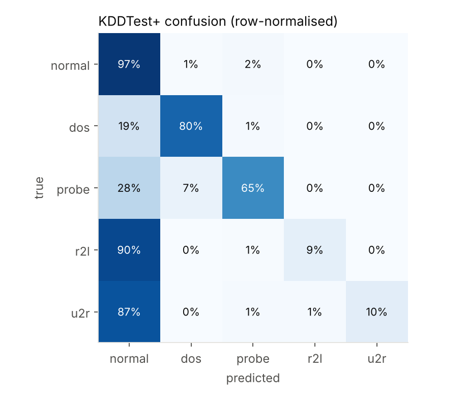

# Kavach-Edge - on-device threat, phishing and scam detection for Arm

*Bharat AI-SoC Challenge 2026-27, Problem Statement 3 (On-device Threat, Phishing & Scam Detection).*

**What it is.** A 3.6 MB bundle of small, explainable models that runs entirely on a phone or Raspberry-Pi-class Arm CPU and protects against three things:
scam messages (SMS/WhatsApp), phishing and look-alike links, and suspicious network activity (port scans, SYN/ICMP floods). It never needs the internet; this is verified
statically, at runtime, in an empty network namespace, and (to be recorded) on the phone in airplane mode.

**How it decides.** Each input becomes *evidence*: a wording model (hashed n-gram logistic regression), 24 interpretable rules (19 scam, 5 genuine-notice) written for the Indian scam landscape
(KYC threats, fake UPI collect requests, "digital arrest", delivery/utility cut-off, job-task and investment scams, remote-access apps), a link model with brand look-alike detection,
and for networks a gradient-boosted model over the 28 header-only NSL-KDD features. A small constrained logistic "stacker" fuses the evidence into one calibrated risk score with
three bands (safe / suspicious / dangerous). Thresholds are chosen at fixed false-alarm budgets, not at 0.5.

**Why it is trustworthy.** The detector decides; the on-device Llama 3.2 1B may only *explain* the structured evidence, never sees the message text, and its output is checked (invented numbers or
links, contradicting the verdict, unsupported topics) before it is shown, with a deterministic template as fallback. The action steps always come from a fixed playbook. Llama explanations have been
tested in English on the phone; the template explanations also exist in Hindi.
Evidence records carry no copy of the message. Every number in this report is generated by a script in the repository from data it names.

**Headline results** (details and 95 % confidence intervals in section 3):

| Task | Test set | Result |
|---|---|---|
| Scam messages | locked hand-written test, held out from all fitting (see the disclosure in section 2) (50 scam / 48 genuine) | **86% of scams flagged at 12.5% false alarms**; blocking level: 80% caught at 8.3% |
| Scam messages | public corpora, held-out split (n=3268) | 98.0% caught at 0.6% false alarms (AUC 0.998) |
| Phishing links | locked hand-written URL test | 91% caught at 2% false alarms; independent top-domain check: 1.53% flagged (n=6000) |
| Network attacks | NSL-KDD official KDDTest+ (unseen attack variants) | 62% of attacks flagged at 2.8% false alarms (AUC 0.968); DoS 80%, probe 70%; R2L/U2R 9%/13% - stated limitation |
| Speed on the phone | Vivo V40e (Dimensity 7300), inside the Android app, median of 3 runs (section 5) | 1.54 ms median / 3.59 ms p95 per message; 3.6 MB models; app PSS 117 MB |
| Llama advisor on the phone | Llama 3.2 1B INT4, ExecuTorch, CPU (section 4, 5.4) | first token 2614 ms, 14.5 tokens/s, full explanation 5724 ms |

The locked hand-written test is deliberately the harder, out-of-distribution number; the in-distribution scores are higher and are reported alongside, not instead.


# 1. Problem, threat model and approach

**Problem.** Indians receive a constant stream of scam SMS/WhatsApp messages and phishing links; cloud-based filters need connectivity, send message content to a server, and are
unavailable exactly when a user is on a weak network. Home and small-office networks are also scanned and flooded with no tooling visible to the user.

**Threat model.** (1) Messages that impersonate banks, government, delivery or utilities and push the user to click, call or share credentials; (2) links whose address imitates a known brand or
uses throw-away hosting; (3) hostile traffic on the local network (reconnaissance scans, SYN floods, ICMP floods, smurf-style reflections). Out of scope: malware analysis, payload-level attacks hidden in
encrypted traffic, voice calls.

**Design principles.** (a) *Private by construction* - no network code in the detector package, verified automatically. (b) *Small and fast* - NumPy-only runtime so it is designed to run on Termux/Pi with no native
ML runtime (install on-device still to be verified, see section 5). (c) *Explainable* - every verdict is a sum of named, signed contributions. (d) *Low false alarms* - thresholds are set from a false-alarm budget; trusted domains and genuine
OTP/transaction notices are modelled explicitly, because a guard people switch off protects nobody. (e) *Honest evaluation* - locked test sets and confidence intervals.

**Architecture.**
```
SMS / chat text ──► normalise ─► wording model (hashed n-grams, Platt-calibrated) ─┐
                         └────► 19 scam + 5 genuine-notice rules ───────────────────┤
links in text / URL ───► host model (trees + n-grams) + brand/look-alike/TLD rules ─┼─► constrained stacker ─► risk 0-1 ─► SAFE / SUSPICIOUS / DANGEROUS
pcap / live flows ─────► connection rebuilder ─► KDD window features ─► tree model ─┘                         │
                                                                                                           ▼
                                                           Evidence JSON (kavach.evidence/1.0, no raw text) ─► UI  and  on-device LLM explainer (grounded)
```
Models: `sms_lr.bin` (1 MB float32 weights), `url_hgb.npz` + `url_ngram.bin`, `net_hgb.npz`, `fusion.json`; trees are exported to flat arrays and evaluated by a ~40-line NumPy runtime (bit-level
parity with scikit-learn, 7e-15) because ONNX export of histogram gradient boosting is not supported and ONNX Runtime is awkward on Termux.


# 2. Data and methodology

**Message data.** UCI SMS Spam Collection; user-reported smishing from the IMC 2025 study (Agarwal et al., CC BY 4.0; India-heavy); and synthetic genuine Indian messages (bank/UPI notices, OTPs,
orders, appointments, chat in English/Hinglish) generated from templates, because public corpora contain very few genuine Indian transactional messages. Reported smishing contains some genuine
OTP/bank notices that users forwarded; a label-noise filter removes reported messages that match genuine-notice patterns.
**URL data.** Phishing.Database active links (positives); Tranco top-1M (benign hosts, trusted allow-list); OpenDNS top domains (an independent benign set used only for a false-alarm check).
**Network data.** NSL-KDD with the official KDDTrain+/KDDTest+ split. Only the 28 features computable from packet headers are used (9 basic, 9 two-second window, 10 host window); the 13 payload-content
features are dropped - this lets the same features be rebuilt from a live capture or a pcap, and works on encrypted traffic.

**Leakage controls** (the usual way scam detectors get inflated numbers):
* SMS train/validation/test are split by *skeleton group* (text with digits/URLs/names masked), so near-duplicate templates never straddle splits; synthetic genuine messages are split by row.
* URLs are split by *registered domain* (shared-hosting platforms such as `*.github.io` by full host), so the model cannot memorise a domain.
* The URL model sees the host only (no path/query) to avoid source shortcuts between the phishing feed and the benign list; path features appear only in the rule layer.
* TLD phishing rates are computed from the training split only. The shared-hosting list is derived from the data (>=40 hosts per registered domain).
* Fusion and thresholds are fitted on validation composites plus the DEV hand-written benchmark. A second hand-written benchmark (**LOCKED TEST**) was written separately and has never been used for training, fitting or threshold choice.
  Disclosure: after the first full evaluation the rule set was refined once (a bare "congratulations" no longer counts as a reward lure; three genuine-notice rules were added: delivery hand-over OTP, branch-visit KYC reminders, "do not click links" warnings). The refinements were chosen by reading the false alarms on the DEV set only - the locked messages were not inspected - but the aggregate locked numbers from the first run had been seen, so treat the locked test as *lightly* contaminated at the level of one tuning round. Locked-test results before the refinement: 84 % caught at 14.6 % false alarms (flag), 80 % at 4.2 % (block); after: see section 3. The change in block-level false alarms (2 -> 4 of 48 genuine messages) is within sampling noise.

**Fusion and thresholds.** Features are the wording-model logit, the (max) link-model logit, rule indicators and a has-link flag. Weights are fitted by L-BFGS-B with sign constraints (scam rules and
models >= 0, genuine-notice rules <= 0) and an L2 pull toward hand-set priors, so the fused model cannot learn that a scam keyword is "safe". Thresholds: dangerous = lowest score with <= 0.5 % false alarms,
suspicious = <= 3 % (weighted quantiles on fit data). Network thresholds are fixed at 0.5 / 0.9 on the calibrated attack probability.

**Metrics.** Recall, false-alarm rate, precision, AUC, each with a Wilson 95 % interval; and *precision at a 1 % scam prevalence* (a realistic inbox), because precision on a roughly 50/50 test set overstates real-world usefulness.
At 1 % prevalence: on the public held-out split (0.6% false alarms) precision is 63%; on the harder locked hand-written test (12.5% false alarms) it falls to 6% at the flag level and 9% at the block level.
That gap is the central open problem of this project - a real inbox sits somewhere between those two sets - and is why the UI treats SUSPICIOUS as a soft warning, only DANGEROUS blocks, and why the roadmap starts with real consented inbox data.


# 3. Evaluation

All rates are shown with 95 % Wilson confidence intervals. 'Flag' = SUSPICIOUS or DANGEROUS; 'block' = DANGEROUS.

### 1. Scam message detection (SMS / chat)

| Set | n (scam/legit) | recall (flag) | false-alarm rate (flag) | recall (block) | false-alarm (block) | AUC |
|---|---|---|---|---|---|---|
| A. public-corpora TEST split (in-distribution) | 1348/1920 | 98.0% [97-99] | 0.6% [0.3-1.0] | 95.9% | 0.0% | 0.998 |
| B. composite TEST (text+URL, in-distribution) | 1348/1920 | 98.7% [98-99] | 1.6% [1.1-2.2] | 97.0% | 0.4% | 0.998 |
| C. KavachBench-IN DEV (tuned on - optimistic) | 86/78 | 89.5% [81-94] | 9.0% [4.4-17.4] | 80.2% | 1.3% | 0.971 |
| **D. KavachBench-IN LOCKED TEST (out-of-distribution)** | 50/48 | 86.0% [74-93] | 12.5% [5.9-24.7] | 80.0% | 8.3% | 0.927 |

**Ablation on the locked test** (each variant re-fitted on the same data, same 3 % false-alarm budget):

| Variant | recall | false-alarm | AUC |
|---|---|---|---|
| text model only | 60.0% [46-72] | 8.3% [3.3-19.6] | 0.863 |
| rules only (SMS + URL rules) | 82.0% [69-90] | 8.3% [3.3-19.6] | 0.908 |
| text model + SMS rules | 74.0% [60-84] | 8.3% [3.3-19.6] | 0.913 |
| text model + URL model/rules | 74.0% [60-84] | 14.6% [7.2-27.2] | 0.887 |
| FULL fusion | 86.0% [74-93] | 12.5% [5.9-24.7] | 0.927 |

Per-category recall on the locked test: bank_kyc 10/10, credential_theft 4/5, upi_scam 3/3, refund 1/1, reward 4/5, job 3/3, investment 1/2, utility 2/3, delivery 3/3, authority 8/8, family 1/1, remote_access 2/3, loan 0/1, romance 1/1, advance_fee 0/1

### 2. Phishing URL detection

* Host-only ML model on the held-out TEST host split: AUC **0.929**, TPR at 1 % FPR **61.4%** (benign hosts are sampled across the whole Tranco rank range, so many are obscure long-tail domains - a deliberately hard setting).
* Full URL analysis (ML + rules, path/query visible) on pathful URLs built from the TEST hosts: recall=71.7% [70.4-72.9]  fpr=2.7% [2.3-3.2]  AUC=0.948
* Hand-written URL dev bench (n=128): fused recall=96.8% [89.1-99.1]  fpr=3.1% [0.8-10.5]  AUC=0.992; host-model alone recall=98.4% [91.5-99.7]  fpr=78.5% [67.0-86.7]  AUC=0.901
* Hand-written URL locked test bench (n=76): fused recall=90.6% [75.8-96.8]  fpr=2.3% [0.4-11.8]  AUC=0.972; host-model alone recall=93.8% [79.9-98.3]  fpr=75.0% [60.6-85.4]  AUC=0.864
* Independent benign source (OpenDNS top domains, n=6000): false-alarm rate **1.53%** (flag), 0.80% (block).

### 3. Network intrusion detection (NSL-KDD, official KDDTest+)

* 28 deployable features, flag threshold 0.5: accuracy=77.2%  recall=62.1% [61.3-63.0]  fpr=2.8% [2.5-3.1]  precision=96.7%  AUC=0.968
* Recall by attack family: dos 80% (n=7458), probe 70% (n=2421), r2l 9% (n=2887), u2r 13% (n=67)
* Ablation (argmax, 5-class): all 41 features acc 77.1% / AUC 0.971; deployable 28 features acc 76.4% / AUC 0.968 - dropping payload-inspection features costs little.
* R2L / U2R attacks (password guessing, privilege escalation) are largely invisible to header-only features; KDDTest+ also contains attack variants absent from training. These limits are stated, not hidden.

**Synthetic pcap functional tests** (fixtures, *not* an accuracy benchmark):

| pcap | connections | flagged | alerts | result |
|---|---|---|---|---|
| normal_browsing | 110 | 0 | - | PASS |
| port_scan | 1024 | 1005 | port scan | PASS |
| syn_flood | 3000 | 3000 | SYN flood from many (possibly spoofed) addresses | PASS |
| ping_flood | 600 | 533 | ping flood | PASS |
| smurf_like | 400 | 400 | ICMP echo-reply flood (smurf-like) | PASS |







# 4. Evidence JSON, grounded advisor and privacy

**Evidence record (`kavach.evidence/1.0`, schema in `schemas/evidence.schema.json`).** Verdict (band, risk, confidence, thresholds), category, ranked signed signals (model and rule contributions with
plain-language descriptions), extracted entities (hosts, registered domains, flow statistics), a closed catalogue of remediation action ids (English/Hindi), and a privacy block
(`processed_on_device: true`, `network_calls: 0`, `raw_text_included: false`, rule snippets capped at 40 characters). The test-suite validates every evidence type against the schema and asserts the
message sentence is never copied into the record.

**On-device Llama advisor (built and measured on the phone).** The Android app (`android/`) runs the whole chain on the Vivo V40e with no network permission:

1. *Detector, unchanged.* The app embeds Python with Chaquopy (Python 3.12, NumPy 1.26.2) and runs the same `kavach/` package that produced every number in section 3. On 292 development
   messages and links, phone and laptop (NumPy 2.2.6) gave identical verdicts, categories and risk scores.
2. *Verdict first.* Risk fusion decides the band; the screen shows it before the language model starts. The model never sets or changes the verdict.
3. *Llama explains.* Llama 3.2 1B Instruct (SpinQuant INT4 export from `executorch-community`, about 1.1 GB, pushed with adb, not in the APK) runs through ExecuTorch (`executorch-android` 1.1.0,
   XNNPACK on the CPU), temperature 0, at most 96 new tokens. Its prompt, `advisor.build_explain_prompt`, contains only detector facts (verdict, risk, confidence, scam type, the top reasons,
   flagged domains) - never the message text - and asks for 2-3 sentences whose stance follows the verdict ("very likely" / "may be" / "no warning signs").
4. *Steps come from the playbook, not the model.* The action steps on screen are the remediation catalogue entries, word for word.
5. *Output checks, then fallback.* `kavach_bridge.finalize` shows Llama's text only if it passes all checks: no phone number or link absent from the evidence; no sentence sending the user to a
   link or number; no contradiction of the verdict; no certainty claims ("100 %", "definitely", a flat "this is a scam"; "likely" for a *suspicious* verdict); no claim that the user has already
   been harmed; and no mention of OTP/PIN, phone calls, payments or app installs unless a detector signal supports it. Otherwise the screen shows the deterministic template with the same shape.

*Why the prompt is narrow.* The first version gave Llama the wider `build_prompt` (facts plus the allowed actions). On the phone it turned the action "Do not call back the number in the message"
into the claim "the message asks you to call a number" - for a message with no number - and said the message asked for a PIN/CVV when no signal said so. Those outputs are now test cases.

*Measured on the phone* (section 5.4): first token after 2614 ms, 14.5 tokens/s while writing, 5724 ms for the whole explanation, peak app memory 1862 MB;
Llama's text passed the checks for 9 of 10 scam messages per run.

**Prompt injection.** 30 synthetic attack messages (`data/build_injection_set.py`): instruction overrides in English, Hindi and Hinglish, fake Llama chat tokens, fake facts JSON,
"verified by RBI" claims, a planted helpline and link, role-play, zero-width characters, benign padding, and a false-alarm attempt on a genuine OTP. Results (`scripts/eval_injection.py`,
`tests/test_prompt_injection.py`):
* attacks that **lowered** the detector's verdict: **0**; attacks whose text reached the Llama prompt: **0**;
* attacks that **raised** the verdict: 6 (the added "verified" claims and planted numbers/links look like scam wording themselves; recorded, not tuned away);
* on the phone, verdicts matched the laptop for 30 of 30; Llama never repeated a planted number or link and never called a scam safe; with the final checks
  25 explanations were shown and 5 fell back to the template (three "you have been scammed" claims caught, two harmless texts rejected by over-strict checks).

The checks are pattern-based. They fail towards the template, but they cannot prove that every sentence is supported by the evidence; a measured faithfulness rate on a labelled set of Llama
outputs is roadmap work (section 7).

**Privacy.** No networking module is imported anywhere in `kavach/` (enforced by a test). Section 4.1 reproduces the automated offline proof.


### Offline-operation proof (auto-generated by offline_proof/verify_offline.py)

Run: 2026-11-22T02:37:01+0000. Claim: *the detector needs no network at any point - install, load, inference, advisor prompt or pcap analysis.*

| # | Test | What it shows | Result |
|---|---|---|---|
| 1 | Static import audit | 13 source files in `kavach/` import no networking module | PASS |
| 2 | Runtime audit hook + blocked sockets | 344 verdicts and 6 pcaps (with advisor prompts) produced **0** network events; negative control (deliberate connect) caught = True | PASS |
| 3 | Interface byte counters | non-loopback interfaces ['ifb0', 'ifb1', 'eth0']; counters moved during the window: {'eth0': {'rx_bytes': 66, 'rx_packets': 1, 'tx_bytes': 289, 'tx_packets': 1}} | informational |
| 4 | Empty network namespace (`unshare --net`) | same verdict digest as the normal run: True; zero events | PASS |

Modules matching networking names that got loaded at runtime: `['urllib', 'urllib.parse']` (stdlib `http`/`urllib` may be pulled in by unrelated stdlib modules; loading is not use - test 2 counts actual network events).

**Phone-level proof (airplane mode + tcpdump):** `offline_proof/PHONE_PROTOCOL.md` - still to be run on the device and attached as a screenshot/pcap.


# 5. Hardware and performance

*Generated by `bench/make_report.py` from `results/bench/*.json`. Protocol: `bench/BENCHMARK_PROTOCOL.md`. Every cell is a measurement or the word **PENDING**.*

## 5.1 Measured on Arm hardware

| Device | CPU | runs | cold start (load + first verdict) | message p50 / p95 / p99 | URL p50 | throughput | RSS / PSS (detector) | RSS with pcap parser | detector files |
|---|---|---|---|---|---|---|---|---|---|
| phone_arm64 | 0xd41 (8 cores) | 3 | 393 ms | 1.54 / 3.59 / 3.93 ms | 1.55 ms | 524 msg/s | 243 / 117 MB | 289 MB | 3.62 MB |

Targets: p95_ms 50, cold_s 1.0, rss_mb 150, model_mb 10.

* **phone_arm64** targets: p95 < 50 ms: MET; cold start < 1 s: MET; RSS < 150 MB: MISSED; model files < 10 MB: MET

**phone_arm64: conditions and method**

* run 1: Vivo V40e (V2403), MediaTek Dimensity 7300, 8 GB RAM, Android 16 (OriginOS 6); Kavach app, detector via Chaquopy (Python 3.12, NumPy 1.26.2) in the app process; screen on, app in foreground, phone on USB; Extended RAM off (user-confirmed, phone restarted before the run); conditions at run start: airplane=0 swap_mb=8191 battery=43% batt_temp=36.8C usb_power=true ac_power=false brightness_auto=0 uptime_min=21 (run 1 of 3)
* run 2: Vivo V40e (V2403), MediaTek Dimensity 7300, 8 GB RAM, Android 16 (OriginOS 6); Kavach app, detector via Chaquopy (Python 3.12, NumPy 1.26.2) in the app process; screen on, app in foreground, phone on USB; Extended RAM off (user-confirmed, phone restarted before the run); conditions at run start: airplane=0 swap_mb=8191 battery=43% batt_temp=37.1C usb_power=true ac_power=false brightness_auto=0 uptime_min=25 (run 2 of 3)
* run 3: Vivo V40e (V2403), MediaTek Dimensity 7300, 8 GB RAM, Android 16 (OriginOS 6); Kavach app, detector via Chaquopy (Python 3.12, NumPy 1.26.2) in the app process; screen on, app in foreground, phone on USB; Extended RAM off (user-confirmed, phone restarted before the run); conditions at run start: airplane=0 swap_mb=8191 battery=43% batt_temp=37.1C usb_power=true ac_power=false brightness_auto=0 uptime_min=29 (run 3 of 3)
* cold start (n=4): Kavach Android app after am force-stop (Chaquopy); load_ms = import + Detector(); python_start_ms (Python.start) is extra and reported separately; Python start p50 382 ms comes on top of the cold start shown above.
* **Deviation from protocol: airplane mode was OFF** during these runs (the phone was USB-tethering the laptop). The app has no INTERNET permission and the detector has no network code, but radio activity can affect heat and CPU load.
* RSS/PSS are for the whole Android app process (Android runtime + embedded Python + detector), not a bare Python process; the 150 MB RSS target was set for the latter. PSS is the memory Android charges the app.

## 5.2 Development reference (x86 sandbox) - NOT Arm, shown only to localise bottlenecks

| Machine | message p50 / p95 / p99 | URL p50 | throughput | RSS / PSS (detector) | RSS with pcap parser | detector files |
|---|---|---|---|---|---|---|
| sandbox_x86 (`Intel(R) Xeon(R) Processor @ 2.10GHz`) | 0.684 / 1.436 / 1.652 ms | 0.538 ms | 1256 msg/s | 47 / 46 MB | 154 MB | 3.57 MB |

Optimisation done from this profile: the NumPy tree evaluator walked trees one by one (about 8.4 ms per URL); it now walks all trees per level (about 0.5 ms per URL) with bit-level parity (max |diff| 7e-15). Arm cores will be slower than a server core - the Arm table above is the one that counts.

## 5.3 Where the time goes (phone_arm64, per message)

| stage | p50 ms | p95 ms | p99 ms |
|---|---|---|---|
| preprocess | 0.100 | 0.133 | 0.162 |
| sms_model | 0.400 | 0.505 | 0.605 |
| sms_rules | 0.440 | 0.560 | 0.624 |
| url_analysis | 0.002 | 1.925 | 2.166 |
| fusion | 0.084 | 0.127 | 0.148 |
| evidence | 0.207 | 0.690 | 0.761 |

Network monitor (phone_arm64): normal_browsing: 110 connections in 51.7 ms (2126/s); port_scan: 1024 connections in 1071.2 ms (956/s); syn_flood: 3000 connections in 10679.4 ms (281/s); mixed_home_network: 4135 connections in 12441.8 ms (332/s).

## 5.4 On-device LLM advisor (Llama via ExecuTorch)

| Device | runs x samples | time-to-first-token p50 | total p50 | decode tokens/s p50 | prefill tokens/s p50 | output tokens p50 | model load | peak RSS (app) |
|---|---|---|---|---|---|---|---|---|
| phone_arm64 | 3 x 10 | 2614 ms | 5724 ms | 14.5 | 96 | 46 | 3816 ms | 1862 MB |

*phone_arm64: model `Llama-3.2-1B-Instruct-SpinQuant_INT4_EO8.pte`. Measured by: Kavach Android app: ExecuTorch LlmModule in-process (executorch-android 1.1.0, XNNPACK CPU); stats from ExecuTorch's onStats callback; not run_bench --advisor-cmd. Each cell is the median over runs of that run's p50. After the output checks, Llama's text was shown for 9 of 10 messages per run; the rest fell back to the playbook template.*

## 5.5 Sustained load: battery and temperature

**PENDING** - no Arm sustained run recorded. Run protocol section 5 (30 min idle baseline + 30 min workload).


## 5.6 Memory and size summary

| file | KB |
|---|---|
| fusion.json | 3 |
| net_hgb.npz | 295 |
| net_meta.json | 2 |
| psl_multi.json | 82 |
| shared_hosting.txt | 6 |
| sms_lr.bin | 1024 |
| sms_lr.json | 0 |
| tld_rate.json | 20 |
| trusted_domains.txt | 697 |
| url_hgb.json | 1 |
| url_hgb.npz | 378 |
| url_ngram.bin | 1024 |
| **total** | **3531** |

Reproduce: `bash bench/BENCHMARK_PROTOCOL.md` section 3 on the device, then `python3 bench/make_report.py`.


# 6. User study

**PENDING** - the study has not been run yet. Kit: `study/` (protocol, offline app, analysis). After collecting 8-15 participants run `python3 study/analyze_study.py --report` and rebuild this report.


# 7. Limitations and roadmap

**Stated plainly.**
* *Hand-written benchmarks are small* (50+48 locked messages) and written by the team; intervals are wide. They are an out-of-distribution sanity check, not a population estimate.
  The locked test shows 12.5% false alarms at the flag level - too high for a blocking decision, which is why only the DANGEROUS band blocks (8.3%).
* *Synthetic genuine messages* are templated; real inboxes are messier. The composite message+URL test set is constructed, not observed.
* *URL host model alone* is modest (AUC 0.929 on held-out hosts); rules and the trusted-domain list carry much of the precision. Newly registered hosts on clean-looking domains will be missed.
* *Network model*: NSL-KDD is 1999-style data; R2L/U2R recall is near zero (9%/13%); the pcap tests are synthetic fixtures, not live traffic. It is a reconnaissance/flood detector, not an IDS replacement.
* *Language*: wording model and rules are English/Hinglish; Explanations are available in Hindi (Devanagari), but detection has not been validated on Devanagari or other Indian-language scams.
* *Phone measurements have a protocol deviation*: the 3 benchmark runs in section 5 were taken with airplane mode **off** (the phone was tethering the development laptop) and on USB power.
  The 30-minute battery/temperature run, the phone-level offline proof in airplane mode and the user study are still pending; nothing in this report estimates them.
* *App memory*: detector RSS on the phone is 243 MB because it is the whole Android app process (runtime + embedded Python); PSS is 117 MB. With Llama loaded the app peaks at about
  1862 MB, which is a real constraint on 4-6 GB phones.
* *Llama explanations*: a 1B model at INT4 follows instructions loosely (it sometimes gives advice or repeats a sentence); the output checks are pattern-based, catch the failure types seen so far,
  and also reject some harmless text. Faithfulness has not been measured on a labelled set.
* *Detector miss seen during the injection tests*: a plain "it's me on a friend's phone, send money urgently" message is rated safe (risk 0.03). It was not tuned away.

**Roadmap.** Collect real consented inbox samples for calibration; add Devanagari/regional-language detection; port the 40-line tree runtime and the 1 MB linear model to Kotlin (formats are flat arrays)
to drop the embedded Python and its memory; a labelled faithfulness evaluation of Llama's explanations and claim-level (not pattern) checking; incremental on-device threshold adaptation under a
false-alarm budget; a QUIC/TLS-aware network feature set replacing NSL-KDD.
